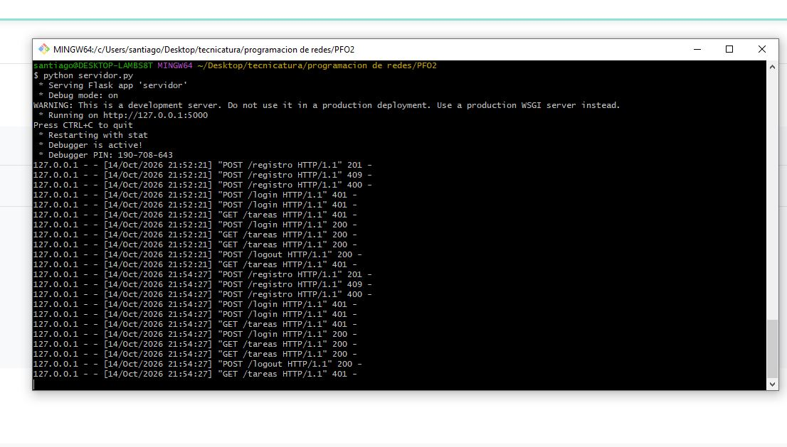
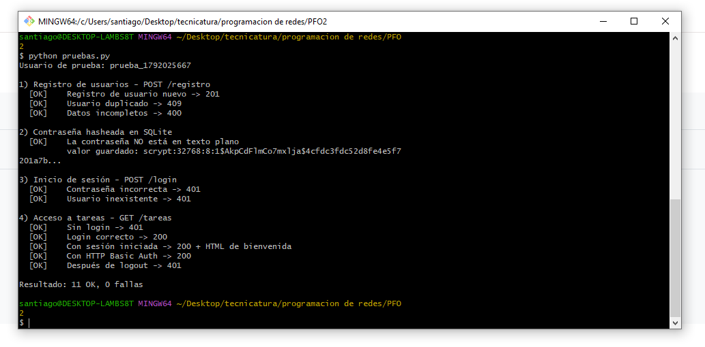
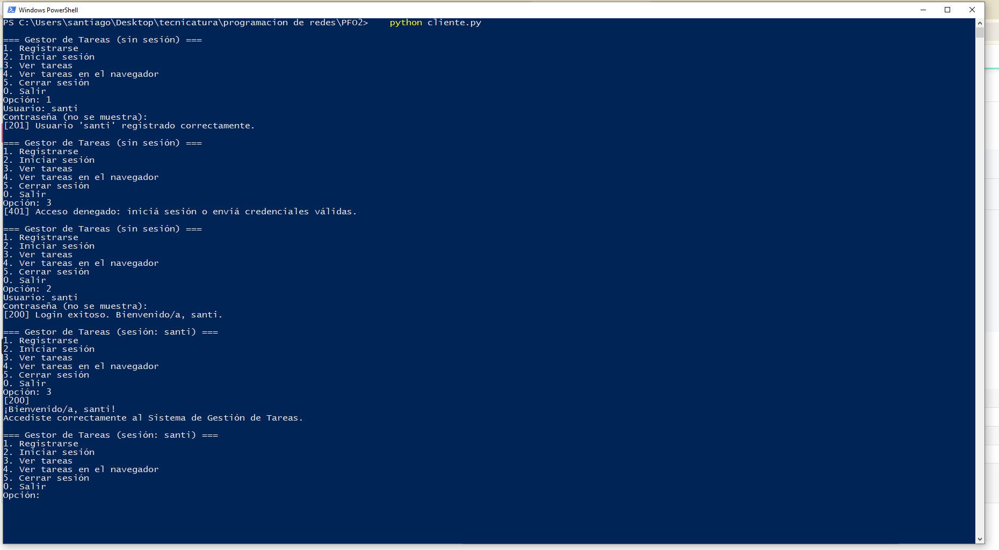
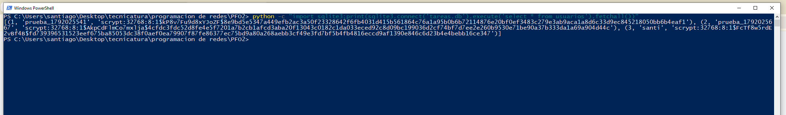

# PFO 2 — Sistema de Gestión de Tareas con API y Base de Datos

API REST en **Flask** con registro e inicio de sesión de usuarios, contraseñas hasheadas y persistencia en **SQLite**, más un cliente de consola que la consume.

## Estructura

```
├── servidor.py        # API Flask + SQLite
├── cliente.py         # Cliente de consola
├── pruebas.py         # Pruebas automáticas de todos los endpoints
├── requirements.txt
├── capturas/          # Capturas de las pruebas
└── README.md
```

## Endpoints

| Método | Ruta        | Body / Auth                                   | Respuestas                                        |
|--------|-------------|-----------------------------------------------|---------------------------------------------------|
| POST   | `/registro` | `{"usuario": "nombre", "contraseña": "1234"}` | 201 creado · 400 datos faltantes · 409 ya existe  |
| POST   | `/login`    | `{"usuario": "nombre", "contraseña": "1234"}` | 200 sesión iniciada · 401 credenciales inválidas  |
| POST   | `/logout`   | —                                             | 200 sesión cerrada                                |
| GET    | `/tareas`   | Sesión iniciada **o** HTTP Basic Auth         | 200 HTML de bienvenida · 401 sin acceso           |

### Cómo funciona la autenticación

- **Registro:** la contraseña se guarda hasheada con `werkzeug.security.generate_password_hash` (algoritmo **scrypt** con salt aleatorio). Nunca se almacena en texto plano.
- **Login:** `check_password_hash` compara la contraseña ingresada con el hash guardado. Si coincide, se crea una **sesión** (cookie firmada por Flask) que habilita el acceso a `/tareas`.
- **`/tareas`:** se puede acceder con la sesión abierta en `/login` o enviando usuario y contraseña por **HTTP Basic Auth**. En este último caso, el navegador muestra su propia ventana de login.

La base `tareas.db` y la tabla `usuarios` se crean automáticamente al iniciar el servidor.

## Instalación

Requisitos: Python 3.9 o superior.

```powershell
git clone https://github.com/SantiCuda/PFO2-programacion-redes.git
cd PFO2-programacion-redes
python -m venv venv
venv\Scripts\activate          # Linux/Mac: source venv/bin/activate
pip install -r requirements.txt
```

## Ejecución y pruebas

### 1. Levantar el servidor (terminal 1)

```powershell
python servidor.py
```

Queda escuchando en `http://127.0.0.1:5000`. Esta terminal tiene que quedar abierta.

### 2. Pruebas automáticas (terminal 2)

Ejecutalo desde la misma carpeta y con el venv activado:

```powershell
python pruebas.py
```

El script verifica estos casos:

| # | Caso | Esperado |
|---|---|---|
| 1 | Registro de usuario nuevo | 201 |
| 2 | Registro de usuario duplicado | 409 |
| 3 | Registro con datos incompletos | 400 |
| 4 | Contraseña guardada como hash en SQLite | no está en texto plano |
| 5 | Login con contraseña incorrecta | 401 |
| 6 | Login con usuario inexistente | 401 |
| 7 | `/tareas` sin login | 401 |
| 8 | Login correcto | 200 |
| 9 | `/tareas` con sesión iniciada | 200 + HTML de bienvenida |
| 10 | `/tareas` con HTTP Basic Auth | 200 |
| 11 | `/tareas` después de logout | 401 |

Resultado esperado: `Resultado: 11 OK, 0 fallas`.

### 3. Cliente de consola (terminal 2)

```powershell
python cliente.py
```

```
=== Gestor de Tareas (sin sesión) ===
1. Registrarse
2. Iniciar sesión
3. Ver tareas
4. Ver tareas en el navegador
5. Cerrar sesión
0. Salir
```

Recorrido sugerido:

1. Opción **3**: sin sesión responde 401.
2. Opción **1**: registrar un usuario.
3. Opción **2**: iniciar sesión.
4. Opción **3**: muestra la bienvenida.
5. Opción **4**: abre el HTML en el navegador.

### 4. Navegador

Abrí `http://127.0.0.1:5000/tareas`. El navegador pide usuario y contraseña (HTTP Basic Auth) y después muestra la página de bienvenida.

### 5. Postman o Thunder Client (opcional)

`POST http://127.0.0.1:5000/registro` → Body → raw → JSON:

```json
{"usuario": "santi", "contraseña": "1234"}
```

Con `/login` es igual. Después, `GET /tareas` en la misma pestaña devuelve el HTML, porque Postman conserva la cookie de sesión.

## Capturas de pruebas exitosas

| Prueba | Captura |
|---|---|
| Servidor corriendo |  |
| Pruebas automáticas: 11 OK |  |
| Cliente: registro, login y tareas |  |
| `/tareas` en el navegador |  |
| Contraseña hasheada en `tareas.db` |  |

## Respuestas conceptuales

### ¿Por qué hashear contraseñas?

Porque la base de datos nunca debe contener las contraseñas reales. Un hash es una función de un solo sentido: a partir de la contraseña se obtiene el hash, pero no se puede revertir. Para validar un login se vuelve a hashear lo que ingresa el usuario y se compara con lo almacenado.

Si la base se filtra (por un robo, un backup expuesto o el acceso indebido de un administrador), el atacante no obtiene las contraseñas en texto plano. Esto es crítico porque los usuarios suelen reutilizar sus contraseñas en otros servicios.

El algoritmo usado (scrypt) suma dos protecciones más:

- **Salt aleatorio por usuario.** Dos usuarios con la misma contraseña tienen hashes distintos, lo que inutiliza las tablas precalculadas (*rainbow tables*).
- **Costo de cálculo deliberado.** Calcular cada hash es lento a propósito, lo que hace muy lentos los ataques de fuerza bruta.

### Ventajas de usar SQLite en este proyecto

- **Sin servidor ni instalación.** Viene incluido en Python (módulo `sqlite3`); no hace falta instalar ni configurar un motor como MySQL o PostgreSQL.
- **Un solo archivo.** Toda la base vive en `tareas.db`, que es fácil de copiar, inspeccionar o borrar para empezar de cero.
- **SQL estándar y transacciones ACID.** Se practica SQL real con garantías de integridad; por ejemplo, la restricción `UNIQUE` impide usuarios duplicados.
- **Liviano y suficiente.** Para un proyecto académico con pocos usuarios y baja concurrencia, el rendimiento sobra.
- **Portable.** Funciona igual en Windows, Linux y Mac.

Como contrapartida, no es lo más adecuado para muchas escrituras concurrentes o para varios servidores compartiendo la base. En ese caso convendría un motor cliente-servidor.

## Nota sobre GitHub Pages

GitHub Pages solo sirve contenido estático, así que no puede ejecutar el servidor Flask. Se usa para publicar la documentación del proyecto (este README); la API se ejecuta localmente siguiendo los pasos anteriores.
